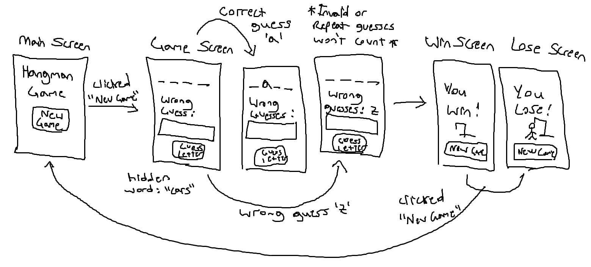
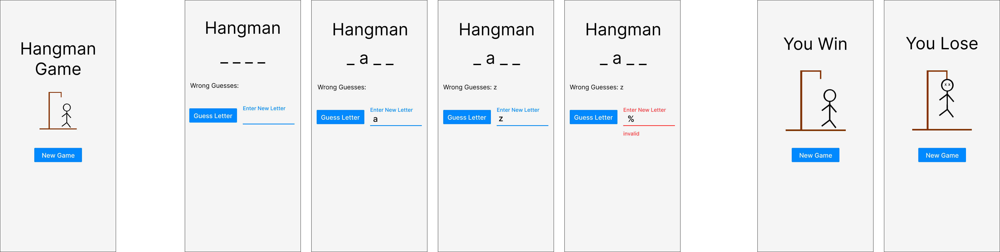
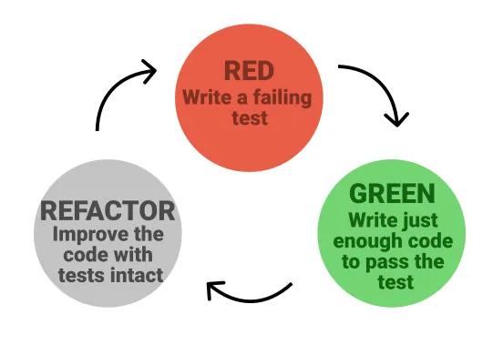
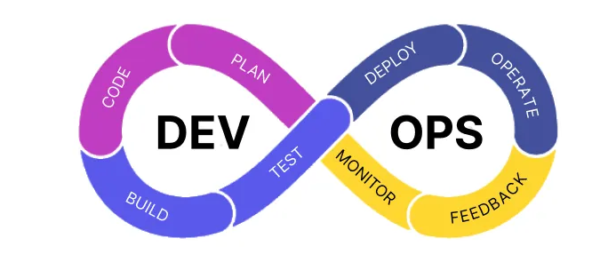

# Hangman Game Project

The purpose of this project is to practice working with Behavior-Driven Design (BDD), Test-Driven Development (TDD) and Continuous Integration (CI).

### Before You Start

Before you start writing any code, remember you will be graded based on your development process and **NOT** just the finished outcome. Make sure to read through this README to have a good understanding of how to complete this project. To avoid losing any points, make sure you follow the rules below.

**Rules:**

- Do **NOT** commit & push directly into the `master` / `main` branch.
- Do **NOT** merge broken code nor failing tests into the `master` / `main` branch. (*You can still commit & push to your other branches*)
- Do **NOT** merge into the `master` / `main` branch without a *Pull Request*.
- Do **NOT** merge into the `master` / `main` branch without a *Code Review*.

<br>

## Design & Planning (Validation)

This phase utilizes <span style="color: #0096FF">**Behavior-Driven Design (BDD)**</span> to determine the application's behavior and fucntionality from the customer's request. For this phase you do not need to add any material, simply read through it to understand the behavior of this application.

### Customer Request:

*"I want a mobile app for users to play the classic hangman game. The game should show the user x amount of underscores so they know the length of the word. The user should only be allowed 7 wrong guesses for pole, head, body, arms (x2), and legs(x2) and they should be shown their wrong guesses. If they guess all the right letters before the complete figure is drawn, they win!"*

Upon hearing their request you draft the following user stories.

### User Stories

- As a player, I should see a row of dashes equal to the hidden word’s length, so that I know how many letters to guess.

- As a player, I should be able to input a single letter, so that I can progress the game and reveal the hidden word.

- As a player, I should see a list of my incorrect guesses, so that I can avoid repeating the same letter.

- As a player, I should not be allowed to input numbers, special characters, nor previous guesses, so that I don't lose a turn.

- As a player, I should be taken to a lose screen where the hidden word revealed after 7 wrong guesses, so that I know I have lost the game.

- As a player, I should be taken to a win screen after correctly guessing the hidden word, so that I know I have won the game.

- As a player, I should have the option to start a new game after being taken to a win or lose screen, so that I can play again.


Using the above user stories, you draft multiple validation sketches and finally the customer agrees to the sketch below.

### Validation Sketch



Messy isn't it? You decide the above validation sketch isn't good enough to serve as your guide, so you quickly draft the low-fidelity prototype below.

### LoFi Prototype



This prototype is much nicer! Use this Figma lofi prototype to serve as your guide for building the application.

<br>

## Testing (Verification)

This phase utilizes <span style="color: #0096FF">**Test-Driven-Development (TDD)**</span> where we develop our tests first based on our validation sketch and lofi prototype then afterwards write code to pass those tests and refactor if necessary.



From the prototypes in the validation phase above you create the following **Acceptance Criteria** in Gherkin style.

### Acceptance Criteria

- For our tests, we'll use `'banana'` as our hidden word.

<div style="color: #4F7942">

### Happy Paths:

- **Given** I am on the *Main Screen*, **When** I click the 'New Game' button, **Then** should be taken to the *Game Screen*.

- **Given** I have started the game **And** I am on the *Game Screen*, **When** I input `'b'` **And** I click the 'Guess Letter' button, **Then** I should see `'b-----'`.

- **Given** I have started the game **And** I am on the *Game Screen* **And** I have previously guessed `'b'`, **When** I input `'n'` **And** I click the 'Guess Letter' button, **Then** I should see `'b-n-n-'`.

- **Given** I have started the game **And** I am on the *Game Screen* **And** I have previously guessed `['b', 'n']`, **When** I input `'z'` **And** I click the 'Guess Letter' button, **Then** I should see `'Wrong Guesses: z'`.

- **Given** I have started the game **And** I am on the *Game Screen* **And** I have previously guessed `['b', 'n']`, **When** I input `'a'` **And** I click the 'Guess Letter' button, **Then** I should be taken to the *Win Screen* **And** see `'You Win'`.

- **Given** I have started the game **And** I am on the *Game Screen* **And** I have previously guessed `['q', 'w', 'e', 'r', 't', 'y']`, **When** I input `'u'` **And** I click the 'Guess Letter' button, **Then** I should be taken to the *Lose Screen* **And** see `'You Lose'`.

- **Given** I have started the game **And** I have won the game by guessing `['b', 'n', 'a']` **And** I am on the *Win Screen*, **When** I click the 'New Game' button, **Then** I should be taken back to the *Game Screen*.

- **Given** I have started the game **And** I have lost the game by guessing `['q', 'w', 'e', 'r', 't', 'y', 'u']` **And** I am on the *Lose Screen*, **When** I click the 'New Game' button, **Then** I should be taken back to the *Game Screen*.
</div>

<br>

<div style="color: #D22B2B">

### Sad Paths:

- **Given** I have started the game **And** I am on the *Game Screen* **And** I have previously guessed `'b'`, **When** I input `'b'` **And** I click the 'Guess Letter' button, **Then** I should see `'already used that letter'`.

- **Given** I have started the game **And** I am on the *Game Screen* **And** I have previously guessed `'q'`, **When** I input `'q'` **And** I click the 'Guess Letter' button, **Then** I should see `'already used that letter'`.

- **Given** I have started the game **And** I am on the *Game Screen*, **When** I input `'@'` **And** I click the 'Guess Letter' button, **Then** I should see `'invalid'`.

- **Given** I have started the game **And** I am on the *Game Screen*, **When** I input `'ab'` **And** I click the 'Guess Letter' button, **Then** I should see `'invalid'`.

</div>

### Unit Tests

After creating your acceptance criteria, you decide to write your unit tests. **Unit tests** are tests that test individual functions rather than user interaction. You also decide to place all your game calculation functions inside a single dart file rather than having many functions spread throughout multiple dart files.

All your game functions will be inside a `HangmanGame` class located in the `lib/models/hangmangame.dart` file.

You create a set of tests in `test/unit_tests.dart` to test the following functions.

- A `guess()` function, that determines if a letter guess is *accepted* or *rejected* as a valid guess by returning `true` or `false` respectively. For any *invalid* guesses it will throw an `ArgumentError`.

```dart
    // pass in the secret word
    var game = HangmanGame('banana');

    expect(game.guess('b'), true); // 'b' is accepted
    expect(game.guess('q'), true); // 'q' is accepted

    expect(game.guess('b'), false); // 'b' not accepted, already used
    expect(game.guess('q'), false); // 'q' not accepted, already used

    expect(() => game.guess('%'), throwsArumentError); // throws argument error
```

- A `status()` function, that determines if the game is ongoing or completed by returning `'play'`, `'win'` or `'lose'`.

```dart
    var game = HangmanGame('banana');

    expect(game.status(), 'play'); // should return 'play'

    game.guess('b');
    game.guess('n');
    game.guess('a');

    expect(game.status(), 'win'); // should return 'win'
```

- A `correctGuesses()` function, to help us keep track of our correct guesses by returning them in a string (ex: `'abc'`).

```dart
    var game = HangmanGame('banana');

    game.guess('b');
    game.guess('n');

    expect(game.correctGuesses(), 'bn') // returns correct guesses
```

- A `wrongGuesses()` function, to help us keep track of our incorrect guesses by returning them in a string (ex: `'def'`).

```dart
    var game = HangmanGame('banana');

    game.guess('q');
    game.guess('w');

    expect(game.wrongGuesses(), 'qw') // returns correct guesses
```

- A `blanksWithCorrectGuesses()` function, to help us organize our dashes and guessed letters.

```dart
    var game = HangmanGame('banana');

    game.guess('b');
    game.guess('n');

    expect(game.blanksWithCorrectGuesses(), 'b-n-n-'); // returns the word with dashes
```

- A `word()` function, to return the hidden word.

```dart
    var game = HangmanGame('banana');

    expect(game.word(), 'banana'); // returns the hidden word
```

### Run the Tests

You can run your tests using the terminal or by using VS Code's UI.

**Terminal:**

Unit tests:

```console
flutter test test/unit_tests.dart
```

Integration tests:

```console
flutter test test/integration_tests.dart
```

**In VS Code:**

1. Open the `test/unit_tests.dart` or `test/integration_tests.dart` file
2. While in the test file select the Debug menu
3. Click the Run Without Debuging option

<br>

## Code Implementation

Now its time for you to start writing code!

Use <span style="color: #0096FF">**Continuous Integration (CI)**</span> when updating your GitHub repository. CI is one of the 2 phases of **DevOps** and it focuses on updating your source code to prevent Regression.



The first step of CI is to setup your **Configuration-as-Code (CaC)**, this step is where you configure your code repository to enforce the CI pipeline.

### Configuration-as-Code

**1. Require Testing:**

- Your current repository already has a `.github/workflows/flutter_test.yaml` file that tells GitHub Actions to run all of the tests when a Pull Request is made.

**2. Require Code Review:**

- Your current repository also has a `pull_request_template.md` file where you and your team must put a description of your Pull Request. (*This is done in GitHub, NOT directly on the file*)

**3. Don't Allow Bypassing Items 1 and 2:**

- Next, set up a **Branch Protection Rule** that instructs GitHub not to allow any changes to the `main` / `master` branch unless it's through a Pull Request, there's no failing tests, and there's a code review.

### Branching

You can create a new branch and update your GitHub repo all from your terminal. Simply create a new branch, the swith over to it, and lastly push to GitHub. You can use the commands below.

```console
git branch new_branch
git checkout new_branch
git push -u origin new_branch
```

### Pull Requests

A pull request is when you request to merge the commits from one branch into another. For this project all of your changes should be done on another branch and NEVER directly on the `main` / `master` branch.

Look at your PowerPoint slides for guidance on how to create Pull Requests.

### Code Review

Your code must be reviewed and given feedback by a team member before it is merged into the `main` \ `master` branch. Look at your PowerPoint slides for guidance on how to *Review* and *Approve* Pull Requests.

### Start Your Project!
